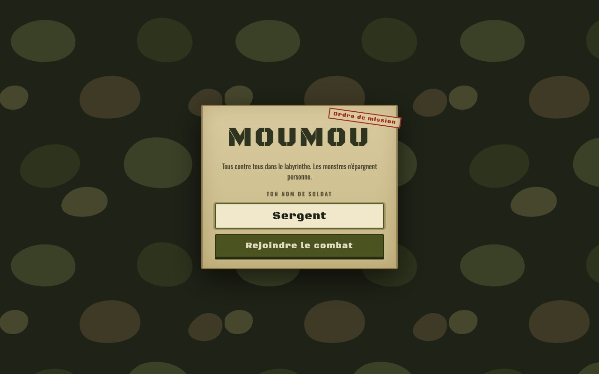
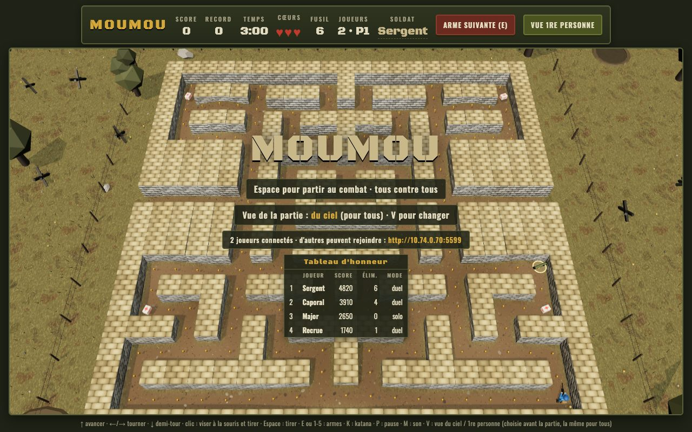
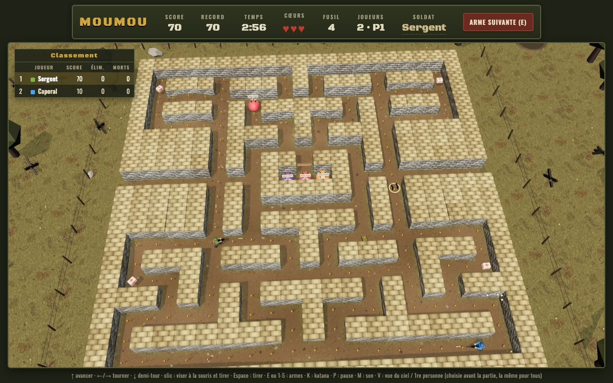
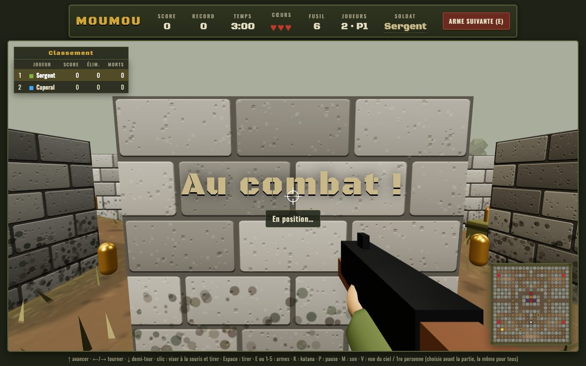
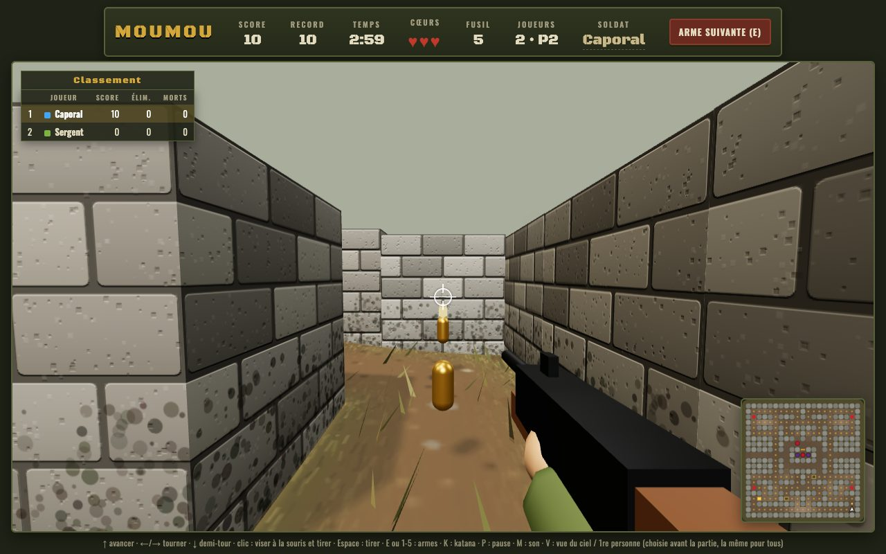

# Moumou

Jeu de guerre en 3D (Three.js) dans un labyrinthe : en solo, ou jusqu'à 6 joueurs en affrontement sur le réseau local.

## Captures d'écran (partie à deux)

| Accueil : chacun choisit son pseudo | Écran titre à deux, avec le tableau d'honneur |
|---|---|
|  |  |

**Manche en vue du ciel** : classement en direct en haut à gauche, chrono de 3 minutes. Le soldat vert (hôte) et le bleu (invité) sont en concurrence, et les monstres sortent de leur repaire au centre.



**Manche en vue 1re personne** (choisie avant la partie, la même pour tous). Sur la minimap, chacun ne voit que sa propre position.

| Hôte (Sergent) | Invité (Caporal) |
|---|---|
|  |  |

## Lancer

```sh
npm start            # http://localhost:5500  (PORT=8080 npm start pour changer de port)
```

Aucune dépendance npm : Node ≥ 18 suffit. Three.js est chargé depuis le CDN jsDelivr (internet requis).

## Jouer à plusieurs (tous contre tous)

1. Lance `npm start` et ouvre `http://localhost:5500`. Un écran d'accueil demande ton pseudo (cliquer sur ton nom dans le bandeau permet d'en changer).
2. L'écran titre affiche l'adresse à donner à tes amis (ex. `http://10.74.0.70:5500`) ; jusqu'à 6 joueurs.
3. Sur l'écran titre, n'importe qui choisit la **vue de la partie** (touche V : du ciel ou 1re personne) ; elle s'applique à tous
   et reste figée pendant la manche. Puis Espace pour lancer.

- Chacun a ses cœurs, son score et ses armes ; balles, roquettes et katana blessent les autres joueurs.
- Éliminer un joueur rapporte +300. L'éliminé revient 3 s plus tard sur le point de départ le plus sûr, avec seulement le fusil.
- Les monstres attaquent tout le monde : 4 en solo, +2 par joueur supplémentaire (8 au maximum).
- La minimap ne montre que soi : la position des adversaires reste cachée.
- Une manche dure 3 minutes, ou jusqu'à ce que toutes les perles soient mangées. Le classement final est enregistré dans
  le **leaderboard** (`server/data/leaderboard.json`, aussi lisible sur `/api/leaderboard`), affiché sur l'écran titre.

Le premier navigateur connecté est l'**hôte** : sa page fait tourner la partie, il doit donc rester au premier plan.
Si l'hôte quitte, les autres pages se rechargent et le premier revenu devient hôte.
Si macOS demande d'autoriser les connexions entrantes pour `node`, accepte.

## Architecture

```
server/                 Node, sans dépendance
  index.js              HTTP (public/) + WebSocket /ws + rechargement auto /__livereload
  websocket.js          WebSocket minimal (RFC 6455)
  room.js               salle de 6 places : relaie l'état de l'hôte vers les invités et leurs commandes vers l'hôte
  leaderboard.js        meilleurs scores, enregistrés dans server/data/ (ou le fichier de MOUMOU_DATA)
  static.js             fichiers statiques
public/
  index.html, css/style.css
  js/main.js            point d'entrée et boucle d'images
  js/core/              données pures, sans Three.js ni DOM
    config.js           carte, règles, armes, joueurs
    terrain.js          cases accessibles, relief, murs
    state.js            état G de la partie (sérialisable) + objet joueur
    events.js           bus d'événements (sons, effets)
  js/game/              simulation : modifie G, émet des événements, ne dessine rien
    game.js             niveaux, caisses, step(), act()
    players.js          déplacements, ramassage, contacts
    enemies.js          IA des monstres
    combat.js           tirs, katana, roquettes, murs destructibles
    sfx.js              raccourcis d'émission d'événements
  js/gfx/               rendu Three.js, piloté par G
    scene.js, world.js, models.js, fx.js, render.js
  js/ui/                intro.js (pseudo), hud.js, minimap.js, input.js
  js/net/client.js      rôle hôte/invité, états, commandes, leaderboard
  js/audio.js           sons WebAudio
  js/dev/livereload.js  rechargement auto (localhost uniquement)
```

**Principe réseau.** L'hôte exécute `game.step()` et envoie l'état `G` (~2,3 Ko) plus les événements de l'image à l'invité.
L'invité ne simule rien : il envoie ses commandes (touches, orientation, vue) et dessine `G` avec le même moteur de rendu.
Le rendu ne lit que `G` : un même code sert donc au solo, à l'hôte et à l'invité.

`npm run check` vérifie la syntaxe de tous les fichiers.
